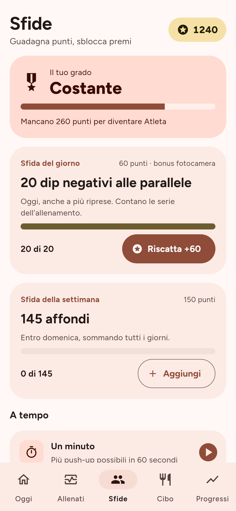
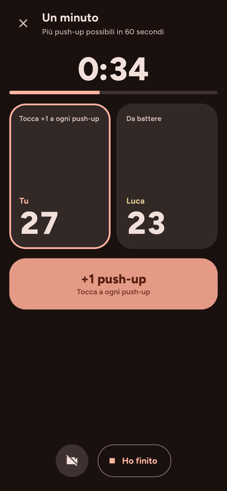
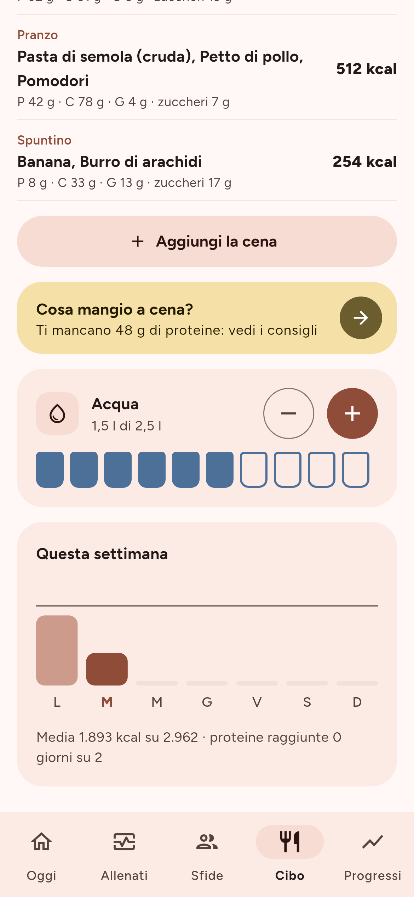
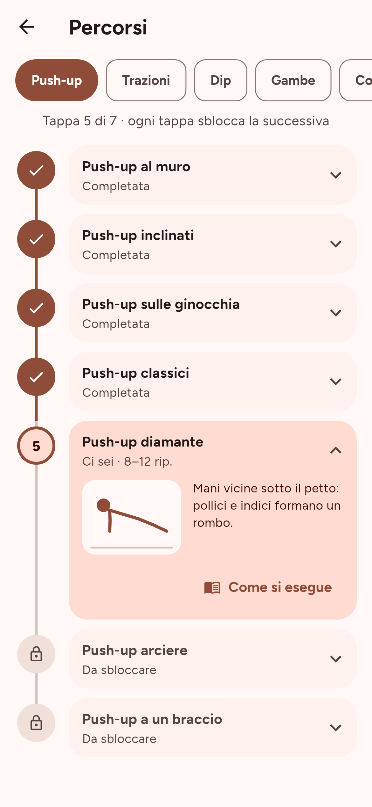
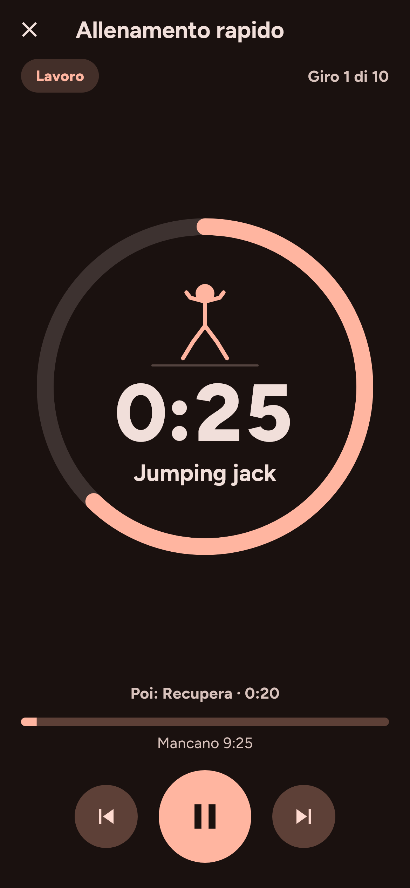
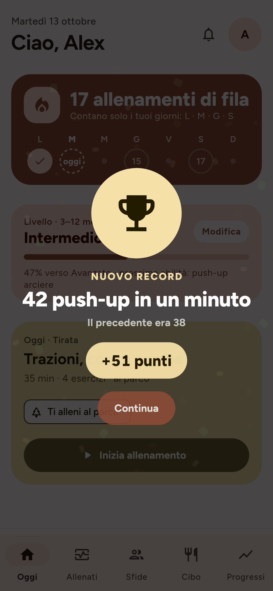

# Discipline

**Calisthenics libera e gratuita.** Allenamenti a corpo libero che si adattano
al tuo livello, una streak che conta solo i giorni che scegli tu, sfide che
ti fanno guadagnare punti e un diario del cibo con consigli. Funziona tutta
**offline**: niente account, niente server.

Discipline è **open source** (licenza GPL-3.0) e **gratis per tutti**: niente
abbonamenti, acquisti in-app, pubblicità o tracciamento.

> Il progetto è sviluppato con l'aiuto dell'intelligenza artificiale (Claude,
> di Anthropic). Il codice è pubblico: chiunque può leggerlo e controllarlo.

[English below](#english)

<p>
  
  
  
  
</p>
<p>
  
  
  
  
</p>
<p>
  
  
  
</p>

## Stato del progetto

Tutte le funzioni sono nel codice e coperte da test automatici (analisi,
test e compilazione Android/iOS a ogni modifica, più una prova di avvio
dell'APK su un emulatore).

Da fare quando avrai un telefono in mano: provare il conteggio con la
fotocamera su un push-up vero e regolare le soglie se serve
(`lib/features/camera/domain/rep_counter.dart`).

## Cosa fa

- **Allenamenti a corpo libero** organizzati in catene di progressione
  (es. push-up al muro → inclinati → classici → diamante → arciere → a un
  braccio), adattati a difficoltà, esperienza e a un test iniziale.
- **71 esercizi**: 7 percorsi a tappe (push-up, trazioni, dip, gambe, core,
  spalle, skill fino a verticale e front lever) più cardio, mobilità e
  complementari per variare. Ogni esercizio ha una figurina animata che
  mostra il movimento.
- **Timer a intervalli**: Tabata, EMOM, AMRAP e libero, con anello, colori per
  fase e bip negli ultimi 3 secondi. Routine guidate di riscaldamento,
  defaticamento e allenamento rapido da 10 minuti.
- **Streak** che conta solo i giorni di allenamento che scegli, con un
  calendario delle ultime 16 settimane.
- **Sfide e punti**: una sfida del giorno e una della settimana tarate sul
  tuo livello, sfide a tempo (Un minuto, Gara a 50) contro il tuo record.
  I punti fanno salire di grado, sbloccano badge e colori dell'app e
  comprano il **giorno jolly**, che salva la serie se salti un allenamento.
  Record, sfide vinte e nuovi gradi si festeggiano con i coriandoli.
- **Sfida un amico senza server**: fai la sfida, mandagli un codice su
  WhatsApp; lui fa la stessa sfida e vede chi ha vinto.
- **Animazioni Material You**: indicatori e pulsanti che scorrono partendo
  veloci e posandosi dolcemente; si spengono con "riduci animazioni".
- **Conteggio dei push-up con la fotocamera**, tutto sul telefono: nessun
  video viene salvato o inviato. Le ripetizioni contate così valgono 1,5
  punti invece di 1.
- **Diario del cibo** con kcal e macronutrienti, ricerca su Open Food Facts,
  scanner del codice a barre e consigli per il prossimo pasto. Puoi tornare
  ai giorni passati, correggere i grammi, creare un alimento dall'etichetta,
  contare i bicchieri d'acqua e vedere la settimana rispetto all'obiettivo.
  Registrare almeno 3 pasti in un giorno vale 10 punti. I valori sono stime
  e non sostituiscono un nutrizionista.
- **Ricette fatte in casa**: metti gli ingredienti con i grammi, il peso
  a fine cottura e le porzioni; Discipline calcola calorie e macro per
  porzione e la salva tra i preferiti.
- **AI per il diario (facoltativa)**: scrivi "a pranzo pasta al pomodoro e
  un'insalata" e l'AI propone gli alimenti con i valori, da controllare
  prima di salvarli. Funziona anche con la **foto del piatto**. Usa una
  tua chiave gratuita di Groq o Google AI Studio, conservata nel
  portachiavi del telefono.
- **Dodici stili grafici**: Material You (Discipline), Liquid Glass, Fluent,
  Cartoon, Svizzero, Neo-brutale, Game Boy, Clay, Cyber HUD, Sport, Zen e
  Kanji, ognuno con colori, caratteri (liberi, inclusi nell'app), forme,
  animazioni e sfondo propri. Si scelgono in Impostazioni.
- **Suoni e vibrazioni**: un suono leggero a ogni tocco e azione (serie
  fatta, allenamento finito, nuovo grado), creato apposta per l'app da
  `tool/make_sounds.py`. Non ferma la musica e si spegne in Impostazioni.
- **Coach AI**: domande su tecnica, dolori, recupero e alimentazione, con
  risposte che tengono conto del tuo livello e di cosa hai mangiato oggi.
- **Cosa cucino?**: l'AI propone una ricetta per i valori che ti mancano,
  rispettando dieta e allergie; la salvi tra le ricette di casa.
- **Dove ti alleni**: casa, casa con sbarra, parco o palestra. Gli esercizi
  che chiedono attrezzi che non hai diventano alternative (rematore sotto
  il tavolo, dip tra due sedie...).
- **Diario del peso** con grafico: il peso più recente aggiorna i consigli
  sul cibo.
- **Aggiornamenti automatici**: una volta al giorno l'app controlla su GitHub
  se c'è una versione nuova e te la propone (si può spegnere).

## Provala sul telefono (Android)

Senza installare nulla sul computer:

1. Apri le **Releases** del repository e scarica il file `.apk` dell'ultima
   versione.
2. Aprilo sul telefono: Android ti chiederà di consentire l'installazione da
   questa fonte.
3. Dalla 1.0 in poi gli aggiornamenti si installano sopra la versione
   vecchia senza perdere i dati: l'app ti avvisa da sola.

**iPhone**: nelle Releases c'è anche il file `.ipa`, da installare
gratis con AltStore o SideStore: [docs/IPHONE.md](docs/IPHONE.md).

Se avevi una versione di prova (0.x), disinstallala prima: era firmata con
una chiave diversa. Come pubblicare una versione:
[docs/PUBBLICAZIONE.md](docs/PUBBLICAZIONE.md).

## Compilarla

Requisiti: [Flutter](https://docs.flutter.dev/get-started/install) stabile
(3.47 o successivo). Per Android serve Android Studio; per iOS un Mac con
Xcode.

```sh
git clone https://github.com/owaismounir206-art/Discipline.git discipline
cd discipline
flutter pub get
flutter run          # su emulatore o telefono collegato
flutter test         # esegue i test
```


## Tecnologie

- [Flutter](https://flutter.dev) e Dart, un solo codice per Android e iOS
- Material 3 (`material_ui`) con colori dinamici su Android 12+
  (`dynamic_color`)
- [Riverpod](https://riverpod.dev) per lo stato, [go_router](https://pub.dev/packages/go_router)
  per la navigazione
- [Drift](https://drift.simonbinder.eu) (SQLite) per i dati sul telefono
- ML Kit (sul telefono) per il conteggio con la fotocamera
- Font [Figtree](https://github.com/erikdkennedy/figtree) (SIL OFL 1.1),
  incluso nell'app

Struttura delle cartelle:

```
lib/
  core/            tema, navigazione, componenti condivisi
  features/<nome>/ una cartella per funzione (today, workout, challenge, rewards, food, progress, camera, settings)
docs/              guida alla pubblicazione e screenshot
design/            schermate di riferimento del design
test/              test automatici
```

## Contribuire

Ogni aiuto è benvenuto: segnalazioni, idee, traduzioni, codice. Leggi
[CONTRIBUTING.md](CONTRIBUTING.md) e il [codice di condotta](CODE_OF_CONDUCT.md).

## Privacy

I tuoi dati restano sul telefono: non c'è nessun account né server. L'unico
collegamento a internet è la ricerca degli alimenti su Open Food Facts. Per
cambiare telefono esporti un file di backup dalle impostazioni. Dettagli in
[PRIVACY.md](PRIVACY.md).

## Licenza

Copyright (C) 2026 Discipline contributors.

Discipline è software libero: puoi redistribuirlo e/o modificarlo secondo i
termini della [GNU General Public License](LICENSE), versione 3 o (a tua
scelta) successiva. Le versioni derivate devono restare libere e aperte.

---

## English

**Discipline** is a free and open source calisthenics app for Android and iOS:
bodyweight workouts that adapt to your level and experience, a streak that
only counts the training days you pick, generated challenges that earn you
points (ranks, badges, unlockable colors, streak freezes), friend challenges
through a shareable code with no server, on-device camera rep counting and a
food diary with suggestions.

- **Free forever**: no subscriptions, in-app purchases, ads or tracking.
- **Open source** under the GNU GPL v3 or later.
- **Privacy first**: fully offline, no account, no server; backups are a
  file you export yourself.
- **Built with AI**: developed with the help of Claude (Anthropic).

The app UI is in Italian for now; translations are welcome.


### Build

```sh
flutter pub get
flutter run
flutter test
```

### Try it

Download the `discipline-apk-prova` artifact from the latest green **CI** run in
the **Actions** tab and install the APK on an Android phone.

### Contributing

See [CONTRIBUTING.md](CONTRIBUTING.md) (Italian, with an English summary).
Issues and pull requests in English are welcome too.
