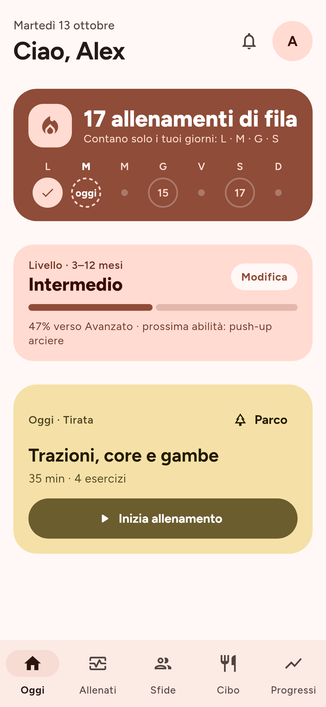
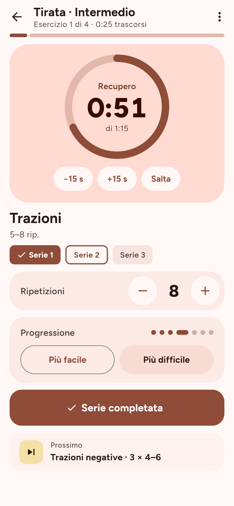
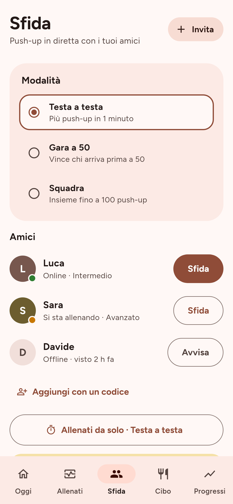
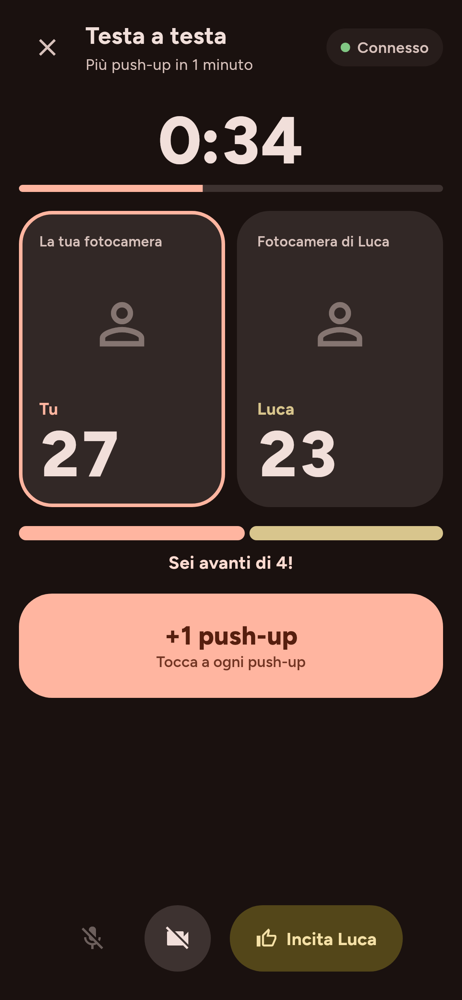
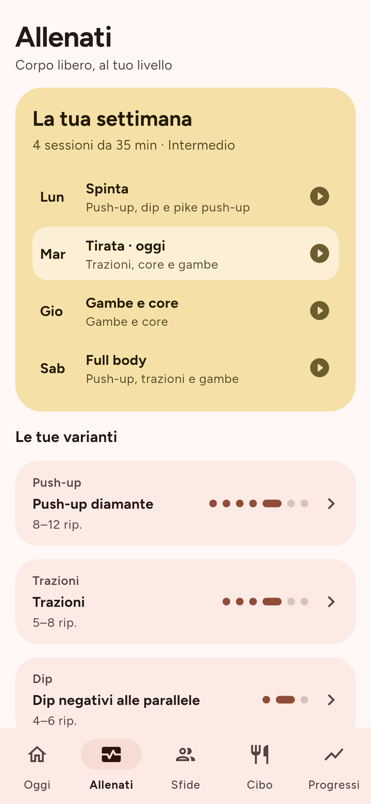
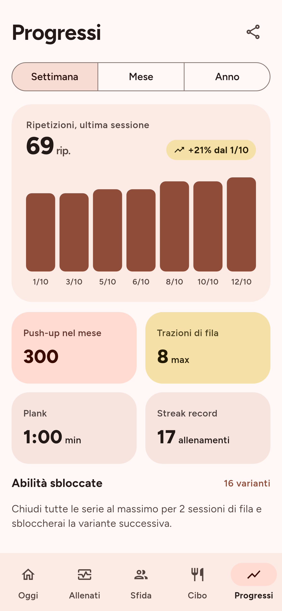
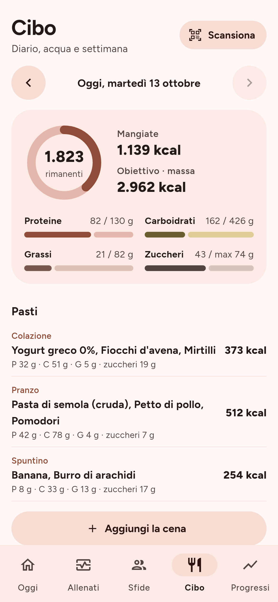
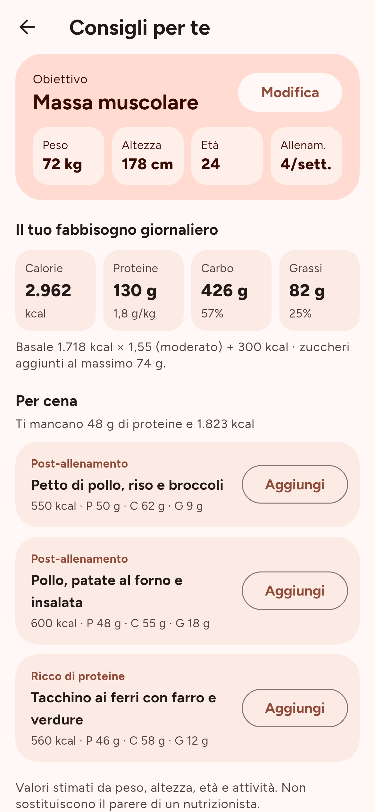

# Ritmo

**Calisthenics libera e gratuita.** Allenamenti a corpo libero che si adattano
al tuo livello, una streak che conta solo i giorni che scegli tu, sfide di
push-up in diretta con gli amici e un diario del cibo con consigli.

Ritmo è **open source** (licenza GPL-3.0) e **gratis per tutti**: niente
abbonamenti, acquisti in-app, pubblicità o tracciamento.

> Il progetto è sviluppato con l'aiuto dell'intelligenza artificiale (Claude,
> di Anthropic). Il codice è pubblico: chiunque può leggerlo e controllarlo.

[English below](#english)

<p>
  
  
  
  
</p>
<p>
  
  
  
  
</p>

## Stato del progetto

Tutte le funzioni previste sono nel codice e coperte da test automatici.
Le parti che richiedono un server (account, amici, sfide online, video)
sono **spente finché non colleghi il tuo server**, gratuito: vedi
[docs/SERVER.md](docs/SERVER.md). Senza server l'app funziona offline e
permette le sfide "da solo".

| Fase | Contenuto | Stato |
|---|---|---|
| 1 | Setup: progetto, tema Material 3, navigazione, file open source | ✅ |
| 2 | Profilo atleta, catalogo esercizi, motore di progressione | ✅ |
| 3 | Oggi e allenamento in corso (timer, serie, varianti) | ✅ |
| 4 | Streak con regole e promemoria | ✅ |
| 5 | Progressi: grafici e record | ✅ |
| 6 | Cibo: diario, Open Food Facts, scanner, consigli | ✅ |
| 7 | Account, amici e backup (Supabase, facoltativo) | ✅ |
| 8 | Sfida multiplayer in tempo reale | ✅ |
| 9 | Conteggio automatico dei push-up con la fotocamera | ✅ |
| 10 | Video e audio nella sfida (LiveKit, facoltativo) | ✅ |
| 11 | Icona, rilasci automatici, guida alla pubblicazione | ✅ |

Da fare quando avrai un telefono in mano: provare il conteggio con la
fotocamera su un push-up vero e regolare le soglie se serve
(`lib/features/camera/domain/rep_counter.dart`).

## Cosa fa

- **Allenamenti a corpo libero** organizzati in catene di progressione
  (es. push-up al muro → inclinati → classici → diamante → arciere → a un
  braccio), adattati a difficoltà, esperienza e a un test iniziale.
- **Streak** che conta solo i giorni di allenamento che scegli.
- **Sfide live** con un amico: Testa a testa, Gara a 50, Squadra.
- **Conteggio dei push-up con la fotocamera**, tutto sul telefono: nessun
  video viene salvato o inviato.
- **Diario del cibo** con kcal e macronutrienti, ricerca su Open Food Facts,
  scanner del codice a barre e consigli per il prossimo pasto. I valori sono
  stime e non sostituiscono un nutrizionista.

## Provala sul telefono (Android)

Senza installare nulla sul computer:

1. Apri la scheda **Actions** del repository e scegli l'ultima esecuzione
   verde di **CI**.
2. In fondo, nella sezione **Artifacts**, scarica `ritmo-apk-prova` (serve
   essere collegati a GitHub) ed estrai lo zip.
3. Copia `app-release.apk` sul telefono e aprilo. Android ti chiederà di
   consentire l'installazione da questa fonte.

È una versione di prova firmata con una chiave di sviluppo. Le versioni
ufficiali (con file `.apk` e impronta SHA-256) sono nelle **Releases**; come
pubblicarle: [docs/PUBBLICAZIONE.md](docs/PUBBLICAZIONE.md).

## Compilarla

Requisiti: [Flutter](https://docs.flutter.dev/get-started/install) stabile
(3.47 o successivo). Per Android serve Android Studio; per iOS un Mac con
Xcode.

```sh
git clone https://github.com/owaismounir206-art/Discipline.git ritmo
cd ritmo
flutter pub get
flutter run          # su emulatore o telefono collegato
flutter test         # esegue i test
```

Per attivare amici, sfide online e video collega il tuo server (gratuito):
[docs/SERVER.md](docs/SERVER.md) e [docs/VIDEO.md](docs/VIDEO.md). Le chiavi
vanno in `config/ritmo.json`, che **non** finisce su GitHub.

## Tecnologie

- [Flutter](https://flutter.dev) e Dart, un solo codice per Android e iOS
- Material 3 (`material_ui`) con colori dinamici su Android 12+
  (`dynamic_color`)
- [Riverpod](https://riverpod.dev) per lo stato, [go_router](https://pub.dev/packages/go_router)
  per la navigazione
- [Drift](https://drift.simonbinder.eu) (SQLite) per i dati sul telefono
- [Supabase](https://supabase.com) (facoltativo, open source) per account,
  amici e sfide in tempo reale; [LiveKit](https://livekit.io) per il video
- ML Kit (sul telefono) per il conteggio con la fotocamera
- Font [Figtree](https://github.com/erikdkennedy/figtree) (SIL OFL 1.1),
  incluso nell'app

Struttura delle cartelle:

```
lib/
  core/            tema, navigazione, componenti condivisi
  features/<nome>/ una cartella per funzione (today, workout, challenge, food, progress, camera, account, settings)
supabase/          schema del database e funzione per il video
docs/              guide (server, video, pubblicazione) e screenshot
design/            schermate di riferimento del design
test/              test automatici
```

## Contribuire

Ogni aiuto è benvenuto: segnalazioni, idee, traduzioni, codice. Leggi
[CONTRIBUTING.md](CONTRIBUTING.md) e il [codice di condotta](CODE_OF_CONDUCT.md).

## Privacy

I tuoi dati restano sul telefono, salvo quando scegli di creare un account o
di sfidare un amico. Nessun dato viene venduto o condiviso. Dettagli in
[PRIVACY.md](PRIVACY.md).

## Licenza

Copyright (C) 2026 Ritmo contributors.

Ritmo è software libero: puoi redistribuirlo e/o modificarlo secondo i
termini della [GNU General Public License](LICENSE), versione 3 o (a tua
scelta) successiva. Le versioni derivate devono restare libere e aperte.

---

## English

**Ritmo** is a free and open source calisthenics app for Android and iOS:
bodyweight workouts that adapt to your level and experience, a streak that
only counts the training days you pick, live push-up challenges with friends
(with on-device camera rep counting) and a food diary with suggestions.

- **Free forever**: no subscriptions, in-app purchases, ads or tracking.
- **Open source** under the GNU GPL v3 or later.
- **Privacy first**: your data stays on your phone unless you sign in or
  start a challenge.
- **Built with AI**: developed with the help of Claude (Anthropic).

The app UI is in Italian for now; translations are welcome.

Online features (accounts, friends, live challenges, video) need a free
Supabase project you set up yourself: see [docs/SERVER.md](docs/SERVER.md).
Without it, the app works fully offline.

### Build

```sh
flutter pub get
flutter run
flutter test
```

### Try it

Download the `ritmo-apk-prova` artifact from the latest green **CI** run in
the **Actions** tab and install the APK on an Android phone.

### Contributing

See [CONTRIBUTING.md](CONTRIBUTING.md) (Italian, with an English summary).
Issues and pull requests in English are welcome too.
